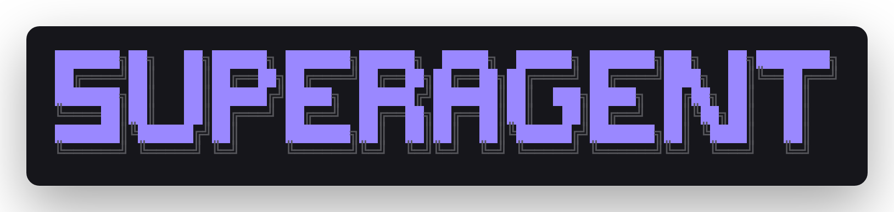
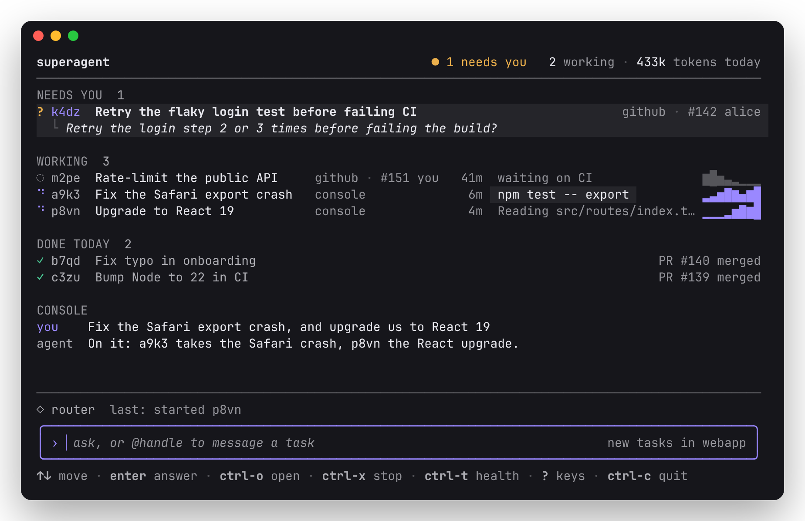

<p align="center">
  
</p>

<p align="center">
  A local, always-on coding agent for macOS and Linux.<br>
  You talk to a Router in a terminal UI. It runs tasks in parallel, each in its own git worktree, and follows their GitHub PRs through review and CI.
</p>

<p align="center">
  
</p>

## Requirements

- macOS or Linux
- git and bash
- A Particle API key
- Optional: [gh](https://cli.github.com), logged in with `gh auth login`, for GitHub

## Install

```sh
curl -fsSL https://github.com/shlokdesai33/superagent/releases/latest/download/install.sh | sh
```

This puts `superagent` in `~/.local/bin`, without sudo, and tells you if that folder isn't on your `PATH`. Add `SUPERAGENT_VERSION=v0.1.0` before `sh` for a given release, or `SUPERAGENT_INSTALL_DIR=<folder>` to install elsewhere.

To build from source, with Bun 1.4.4 or newer:

```sh
git clone https://github.com/shlokdesai33/superagent && cd superagent
bun install
bun run build darwin-arm64   # or darwin-x64, linux-x64, linux-arm64
cp dist/superagent-darwin-arm64 ~/.local/bin/superagent
```

## First run

Open it in a repository you want to work on:

```sh
cd ~/code/webapp
superagent
```

The first time, it asks for your Particle API key. Paste it and press `enter`. `esc` skips it for now; `ctrl-t` then `ctrl-k` brings the screen back to add or replace the key.

## Using it

**Ask.** Type in the input box and press `enter`. The Router answers quick questions under CONSOLE and starts a task for real work, like "Fix the Safari export crash" or "Upgrade to React 19 and fix what breaks". Send as many as you like: tasks run side by side, each on its own `superagent/<handle>` branch.

**Home.** Everything on one screen:

- **NEEDS YOU**: questions from tasks, failed tasks and problems. When nothing needs you, it's gone and the header reads `all calm`.
- **WORKING**: tasks running or waiting on CI, a review or a reply, with what each is doing now.
- **DONE TODAY**: finished and stopped tasks, with their result.

**Open a task.** Select it with `↑` `↓` and press `enter` to see its steps, conversation and report. `esc` goes back.

**Answer a question.** Select it under NEEDS YOU, press `enter`, type your answer and press `enter` again. The task picks up from there.

**Message a task.** Start with its handle: `@a9k3 check Firefox too`. Inside a task, anything you type goes straight to it.

**Stop a task.** Press `ctrl-x` twice on the selected task, or in its view. On a failed task this dismisses it; `ctrl-r` on health (`ctrl-t`) resumes failed tasks instead.

**Hand over GitHub work.** Paste an issue or PR link, or say "fix #42". The task that takes it follows the thread: new comments, reviews, CI results and the merge go straight to it, and so does the PR it opens. Tasks push and open a PR only when you ask for one or they follow a GitHub issue or PR. The Router can reply on the issue, posted as you. `ctrl-o` in a task opens its PR or issue.

**Pick the repository.** New tasks start in the repository you opened `superagent` in; the input box shows `new tasks in <repo>`. While writing, `tab` switches to another repository superagent knows, or none.

## Keys

| Key               | Action                                                        |
| ----------------- | ------------------------------------------------------------- |
| `enter`           | Send; with nothing typed, open the selected task or answer it |
| `↑` `↓`           | Move or scroll; in a draft, move the cursor                   |
| `pgup` `pgdn`     | Move or scroll by five                                        |
| `esc`             | Clear the draft, then go back                                 |
| `tab`             | Change the repository for new tasks                           |
| `ctrl-o`          | Open the selected task; in a task, its PR or issue            |
| `ctrl-x` `ctrl-x` | Stop the task, or dismiss a failed one                        |
| `ctrl-t`          | Health                                                        |
| `ctrl-r`          | Resume failed tasks, on health                                |
| `ctrl-k`          | Add or replace the Particle key, on health                    |
| `?`               | All keys, with nothing typed                                  |
| `ctrl-c`          | Quit; twice with a draft                                      |

## The background agent

The work happens in a background agent that `superagent` starts when it isn't running. Quitting the UI leaves it running, tasks and all. It doesn't start at login: after a reboot, run `superagent` again and the tasks carry on.

| Command                     | What it does                                        |
| --------------------------- | --------------------------------------------------- |
| `superagent`                | Open the UI, starting the agent if needed           |
| `superagent start`          | Start the agent                                     |
| `superagent stop`           | Stop it; working tasks resume on the next start     |
| `superagent restart`        | Stop it and start it again                          |
| `superagent status`         | Its tasks and health; `--json` for the raw snapshot |
| `superagent logs`           | Its log; `-f` keeps printing new lines              |
| `superagent login particle` | Save your Particle API key from the command line    |
| `superagent daemon`         | Run the agent in this terminal, for debugging       |

## Updating

Run the install command again, then `superagent restart` so the background agent runs the new version. The script tells you when that's needed.

## Uninstall

Stop the agent, delete the executable, then delete the data folder. The data folder holds your task history and the tasks' worktrees, along with your settings and Particle key, so first push or copy any work you want to keep.

```sh
superagent stop
rm ~/.local/bin/superagent
rm -rf ~/.superagent
```
